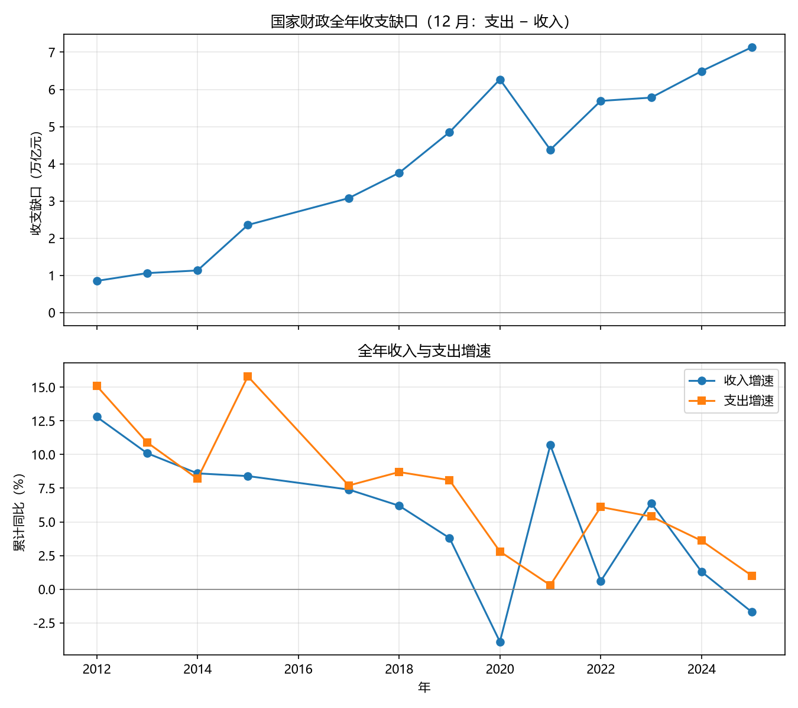

# 少收还是多花？2012—2025 年国家财政全年收支缺口的描述性分析

**课堂案例报告** · 数据分析与可视化 · Week 01  
数据与代码：`weeks/week01/cases/`

---

## 摘要

本文用国家财政收入、财政支出（不含债务还本）的月度表，构造 2012—2025 年**全年收支缺口**（12 月支出 − 12 月收入），回答两个问题：缺口占收入的比重是在扩大还是收窄？扩大时主要是收入走弱，还是支出加力？在剔除量级明显不像全年数的 12 月观测、以及 2016 年 12 月双侧缺失之后，得到 13 个可比较年份。结果显示：缺口占收入由 2012 年的 7.3% 升至 2025 年的 33.0%（7.14 万亿元），总体上台阶；2020 年升至 34.3%，为样本峰值；2021 年是唯一一次明显回落。缺口扩大的年份里，收入增速通常低于支出增速，2020、2022、2025 年尤其如此；2015 年是少数「多花」主导的一年。本文是描述性分解，不识别因果；缺口也不是财政部公布的财政赤字。

**关键词：** 一般公共预算；收支缺口；减税降费；逆周期财政

---

## 1 引言

财政「紧不紧」，媒体常用赤字率或国债发行来讲。对课堂里的一张月度表，更直接的问题是：国家财政**一年收进来的钱**和**一年花出去的钱**（不含还本）差多少？这个差额占收入的比重，近十年是在扩大还是收窄？若在扩大，是少收了，还是多花了？

这两个问题有政策含义。若缺口扩大主要来自收入减速，讨论应落在税基、减税降费和房地产相关税收；若主要来自支出加速，讨论应落在稳增长和支出刚性。二者对「过紧日子」的含义不同：前者是收入端约束，后者是支出端选择。

已有讨论多使用官方赤字、广义政府杠杆或土地出让金。官方赤字会用调入资金、结转结余弥补账面缺口；土地出让金记在政府性基金，不进一般公共预算。本文刻意留在**一般公共预算、不含债务还本**这一窄口径，只描述表内能算清的全年缺口，并说明它与赤字、全口径松紧不是同一件事。

下文安排：第 2 节说明数据与样本筛选；第 3 节给出指标与比较方法；第 4 节报告趋势与增速分解；第 5 节讨论可能机制与口径限制；第 6 节收束。复现代码见附录。

---

## 2 数据

原始文件为 `cases/nation/财政收入-月度数据.xlsx` 与 `财政支出-月度数据.xlsx`（各一张工作表）。两表结构相同：指标时间为「YYYY年M月」，另两列为累计值（亿元）与累计同比（%）。收入列为「国家财政收入」；支出列为「国家财政支出（不含债务还本）」。文件覆盖约 2001 年 1 月至 2026 年 8 月。2026 年 8 月两边都空。收入的 1 月几乎都空（26 年里 25 年）；支出的 1 月多数有数。2001—2009 年的 12 月两边都空，不是被下面第 2 条规则剔除的。

表头写「累计值」。若名副其实，同一年内数值应随月份递增，12 月即全年。核验发现：收入序列大体符合累计；支出序列在 2021 年以前年内并不单调递增，更接近当月发生额，2021 年起才表现为累计。因此**不能把所有月份的「累计值」直接当年来累计使用**。

本文只分析全年，处理如下：

1. 只保留 **12 月** 观测。
2. 要求该年 12 月支出大于当年 12 月收入的 50%。2010、2011 年 12 月支出约 1.8–2.0 万亿元，收入约 8–10 万亿元，支出格仍像当月值，故剔除。
3. 2016 年 12 月收入、支出均为缺失，该年无法进入全年比较。

进入分析的年份为：2012—2015、2017—2025，共 13 年。2026 年尚无 12 月数据，不纳入。

---

## 3 分析方法

记第 *t* 年 12 月的国家财政收入为收入、财政支出（不含还本）为支出；增速用原表自带的累计同比。三个指标分列如下。

| 指标 | 计算 |
| --- | --- |
| 缺口 | 支出 − 收入 |
| 缺口占收入（%） | （支出 − 收入）÷ 收入 × 100 |
| 增速差（百分点） | 支出累计同比 − 收入累计同比 |

缺口为正，表示当年花得比收得多。缺口占收入用于跨年比较，避免绝对额随经济规模上升而不可比。增速差用于判断**该年缺口变化更靠近哪一端**：差为正，表示支出增速高于收入增速（相对「多花」或「少收」的组合）；差为负，表示收入增速高于支出增速（相对收窄）。

本文不做回归或因果识别。比较方式为：观察缺口占收入的水平与拐点；把扩大年、收窄年的收入增速与支出增速对照；结合公开财政事实作**可能机制**讨论，明确相关不等于因果。

实现见 `fiscal_gap.py`：用 pandas 读入、按年月解析、内连接、按第 2 节规则筛选，并输出 `output/annual_gap.csv` 与 `output/fiscal_gap.png`。

---

## 4 结果

图 1 上方面板为全年缺口（万亿元），下方面板为收入、支出累计同比。表 1 列出全部 13 年。



**图 1** 上：12 月支出 − 12 月收入；下：表内累计同比。2016 年没有观测点；折线会从 2015 年连到 2017 年，中间不是 2016 年的真实缺口。

**表 1　全年收支与缺口（12 月，亿元）**

| 年 | 收入 | 支出 | 缺口 | 缺口/收入（%） | 收入增速（%） | 支出增速（%） | 增速差（百分点） |
| --- | ---: | ---: | ---: | ---: | ---: | ---: | ---: |
| 2012 | 117210 | 125712 | 8502 | 7.3 | 12.8 | 15.1 | 2.3 |
| 2013 | 129143 | 139744 | 10601 | 8.2 | 10.1 | 10.9 | 0.8 |
| 2014 | 140350 | 151662 | 11312 | 8.1 | 8.6 | 8.2 | −0.4 |
| 2015 | 152217 | 175768 | 23551 | 15.5 | 8.4 | 15.8 | 7.4 |
| 2017 | 172567 | 203330 | 30763 | 17.8 | 7.4 | 7.7 | 0.3 |
| 2018 | 183352 | 220906 | 37554 | 20.5 | 6.2 | 8.7 | 2.5 |
| 2019 | 190382 | 238874 | 48492 | 25.5 | 3.8 | 8.1 | 4.3 |
| 2020 | 182895 | 245588 | 62693 | 34.3 | −3.9 | 2.8 | 6.7 |
| 2021 | 202539 | 246322 | 43783 | 21.6 | 10.7 | 0.3 | −10.4 |
| 2022 | 203703 | 260609 | 56906 | 27.9 | 0.6 | 6.1 | 5.5 |
| 2023 | 216784 | 274574 | 57790 | 26.7 | 6.4 | 5.4 | −1.0 |
| 2024 | 219702 | 284612 | 64910 | 29.5 | 1.3 | 3.6 | 2.3 |
| 2025 | 216045 | 287395 | 71350 | 33.0 | −1.7 | 1.0 | 2.7 |

可归纳三条规律。

**规律一：缺口占收入在上台阶，不是在均值附近来回波动。** 2012—2014 年稳定在 7%–8%。2015 年跳至 15.5%，此后几乎逐年抬升，2019 年达 25.5%，2020 年达样本峰值 34.3%。2021 年回落到 21.6%，为样本内唯一一次大幅度收窄。随后再次上行：2022 年 27.9%，2024 年 29.5%，2025 年 33.0%（7.14 万亿元），接近 2020 年高位。绝对缺口从 2012 年的 0.85 万亿元增至 2025 年的 7.14 万亿元，规模扩张与占比抬升同时发生。

**规律二：缺口扩大年，多数是收入减速快过支出，而不是支出猛增。** 支出累计同比多数年份落在约 1%–9%；收入同比则从 2012 年的 12.8% 下台阶，近年在 0 附近，2020、2025 年为负。典型组合是：2020 年收入 −3.9%、支出仍 +2.8%；2022 年收入 +0.6%、支出 +6.1%；2025 年收入 −1.7%、支出 +1.0%。这三年增速差均为正，缺口占收入均再上台阶。例外是 2015 年：收入 +8.4%，支出 +15.8%，增速差 7.4 个百分点，更接近「多花」。

**规律三：缺口收窄极难。** 2021 年收入 +10.7%、支出几乎冻结（+0.3%），增速差 −10.4 个百分点，缺口占收入下降 12.7 个百分点。2023 年收入增速略高于支出（6.4% 对 5.4%），缺口占比仅略降（27.9%→26.7%），并未回到疫情前。支出没有出现持续负增长；收入一旦再度走弱，缺口就容易重新张开（2024—2025）。

---

## 5 讨论

上述规律与 2010 年代后期以来的财政政策方向可以对照，但只能当作**时间上的重合**，不能当作识别出来的因果。

缺口长期抬升，与两件事同时发生。一是减税降费：2018 年增值税并档、2019 年个人所得税改革，之后还有留抵退税、小微优惠等，一般公共预算收入增速持续慢于支出。2025 年收入 −1.7%，与「经济总量仍在增长、财政收入下降」的公开表述一致，更像政策减收叠加税基偏弱，而不是整体衰退。二是房地产长周期调整。土地出让金不在本表，但房企利润、土地增值税、契税及部分增值税仍在一般预算中；2018 年后收入增速下台阶、2022 年近零增长、2024—2025 再转弱，时间上与地产调整重合。

支出端更像「逆周期 + 刚性」。民生、「三保」、基本运转和国债项目配套不易随收入同步削减，因此收入掉的年份支出往往仍为正增长。2015 年支出异常快（+15.8%），更接近当年稳增长、基建加力，是样本里少见的支出主导年。2020 年是疫情冲击下的少收；2021 年则是收入低基数反弹叠加支出严控，才一次性把缺口压下来。2022 年疫情反复叠加地产下行，收入几乎不动、支出仍加。2023 年收入修复了一截，但 2024—2025 再次失速，缺口爬回接近 2020 年的水平。

必须强调口径。第一，本缺口是一般公共预算、不含还本，**不是**财政赤字；赤字会用预算稳定调节基金、结转结余、调入政府性基金等弥补。第二，政府性基金（尤其是土地出让）未进入本表，全口径政府「松紧」可能比图 1 更紧。第三，2016 年缺失、2010—2011 年 12 月因量级被剔除，早期趋势不完整。第四，累计同比来自原表，个别年份的统计口径调整会进入增速，但不改变缺口占收入的水平比较。第五，12 月筛选规则（支出 > 0.5 × 收入）是为丢掉当月值混入全年的观测，属于透明但主观的阈值；放宽或收紧会改变 2010—2011 是否入样，不改变 2012 年以后的主结论。

---

## 6 结论

在一般公共预算、不含债务还本、仅用可比较的 12 月数据这一口径下，2012—2025 年国家财政全年收支缺口占收入的比重明显抬升，由约 7% 升至约 33%；2020 年见顶，2021 年一次性回落，其后再次接近峰值。缺口扩大主要对应收入增速下台阶，而不是支出持续猛增；2015 年是例外。缺口要明显收窄，需要「收入反弹 + 支出刹住」同时出现，样本里只有 2021 年做到了。

对课堂的含义有两条。分析前要核验列名与数字是否一致：写着累计值的支出，2021 年前年内并不递增，全年比较必须守住 12 月且量级相当。解释时要把缺口与官方赤字、土地财政分开，避免把一张窄表读成「整个政府」的松紧。更细的税种分解、基金预算和因果识别，超出本案例范围。

---

## 附录　复现代码

运行环境：Python 3.13，依赖 `pandas`、`openpyxl`、`matplotlib`。在 `cases/` 目录执行：

```text
py -3.13 fiscal_gap.py
```

输出：`output/annual_gap.csv`、`output/fiscal_gap.png`。

```python
"""国家财政收支缺口：近十年是「少收」还是「多花」在主导？

只用全年：取 12 月、且支出与收入量级相当的年份（丢掉明显仍是当月值的 12 月，以及两边都空的 2016 年）。
支出为不含债务还本，单位亿元。
"""

from pathlib import Path

import pandas as pd

DATA_DIR = Path(__file__).resolve().parent / "nation"
OUT_DIR = Path(__file__).resolve().parent / "output"


def load_series(filename: str, value_name: str, growth_name: str) -> pd.DataFrame:
    df = pd.read_excel(DATA_DIR / filename)
    df.columns = ["time_raw", value_name, growth_name]
    parsed = df["time_raw"].astype(str).str.extract(r"(\d{4}).*?(\d{1,2})")
    df["year"] = pd.to_numeric(parsed[0], errors="coerce")
    df["month"] = pd.to_numeric(parsed[1], errors="coerce")
    return df.dropna(subset=["year", "month", value_name]).copy()


def main() -> None:
    OUT_DIR.mkdir(exist_ok=True)

    rev = load_series("财政收入-月度数据.xlsx", "revenue", "revenue_yoy")
    exp = load_series("财政支出-月度数据.xlsx", "expenditure", "expenditure_yoy")
    both = rev.merge(exp, on=["year", "month"], how="inner")
    both["gap"] = both["expenditure"] - both["revenue"]
    both["gap_to_revenue"] = both["gap"] / both["revenue"] * 100
    both["growth_gap"] = both["expenditure_yoy"] - both["revenue_yoy"]

    # 12 月：支出至少达到收入的一半，才像全年数而不是当月值。
    annual = (
        both[(both["month"] == 12) & (both["expenditure"] > 0.5 * both["revenue"])]
        .sort_values("year")
        .copy()
    )

    print("问题：近十年国家财政全年收支缺口（支出−收入）是在扩大还是收窄？")
    print("      缺口扩大时，主要是收入掉得快，还是支出加得猛？")
    print()
    print("只用 12 月；支出须与收入量级相当。2016 年 12 月两边都空，故缺一年。")
    print()
    print("—— 全年（12 月，亿元）——")
    cols = [
        "year",
        "revenue",
        "expenditure",
        "gap",
        "gap_to_revenue",
        "revenue_yoy",
        "expenditure_yoy",
        "growth_gap",
    ]
    print(annual[cols].round(1).to_string(index=False))

    latest = annual.iloc[-1]
    y2019 = annual.loc[annual["year"] == 2019].iloc[0]
    y2012 = annual.iloc[0]

    print()
    print("要点")
    print(
        f"- {int(y2012['year'])} 年缺口占收入 {y2012['gap_to_revenue']:.1f}%，"
        f"2019 年为 {y2019['gap_to_revenue']:.1f}%，"
        f"{int(latest['year'])} 年为 {latest['gap_to_revenue']:.1f}%"
        f"（{latest['gap']:.0f} 亿元）。"
    )
    print(
        f"- {int(latest['year'])} 年收入累计增速 {latest['revenue_yoy']:.1f}%，"
        f"支出 {latest['expenditure_yoy']:.1f}%："
        + (
            "缺口扩大主要来自收入走弱。"
            if latest["revenue_yoy"] < latest["expenditure_yoy"]
            else "支出比收入收得更紧。"
        )
    )

    annual[cols].to_csv(OUT_DIR / "annual_gap.csv", index=False, encoding="utf-8-sig")
    print()
    print(f"已写入 {OUT_DIR / 'annual_gap.csv'}")

    try:
        import matplotlib.pyplot as plt
    except ImportError:
        print("未安装 matplotlib，跳过作图。")
        return

    plt.rcParams["font.sans-serif"] = ["Microsoft YaHei", "SimHei", "DejaVu Sans"]
    plt.rcParams["axes.unicode_minus"] = False

    fig, axes = plt.subplots(2, 1, figsize=(9, 8), sharex=True)

    axes[0].plot(annual["year"], annual["gap"] / 10000, marker="o")
    axes[0].axhline(0, color="gray", linewidth=0.8)
    axes[0].set_ylabel("收支缺口（万亿元）")
    axes[0].set_title("国家财政全年收支缺口（12 月：支出 − 收入）")
    axes[0].grid(True, alpha=0.3)

    axes[1].plot(annual["year"], annual["revenue_yoy"], marker="o", label="收入增速")
    axes[1].plot(annual["year"], annual["expenditure_yoy"], marker="s", label="支出增速")
    axes[1].axhline(0, color="gray", linewidth=0.8)
    axes[1].set_xlabel("年")
    axes[1].set_ylabel("累计同比（%）")
    axes[1].set_title("全年收入与支出增速")
    axes[1].legend()
    axes[1].grid(True, alpha=0.3)

    fig.tight_layout()
    fig.savefig(OUT_DIR / "fiscal_gap.png", dpi=150)
    print(f"已写入 {OUT_DIR / 'fiscal_gap.png'}")


if __name__ == "__main__":
    main()
```
